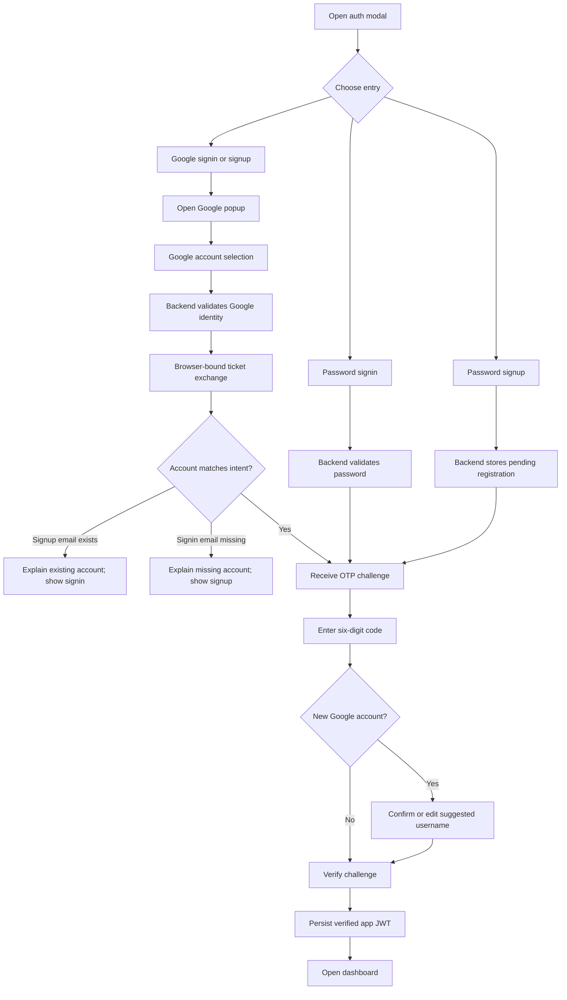
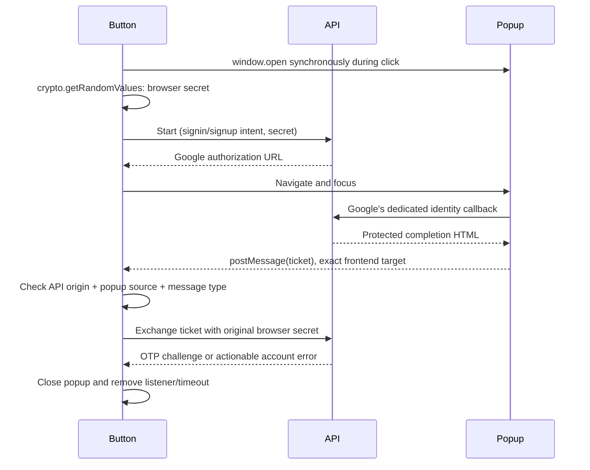

# Google signup and signin frontend

> Current scope (2026-10-23): lead outreach is deferred and preserved on `dev/outreach`. This primary branch contains Google identity authentication only. There are no outreach routes, sending worker, Email Studio, mailbox settings or test-lead mode in this checkout. Older inbox callback/configuration references below describe the deferred branch, not enabled functionality. Existing Google Cloud registrations and private mailbox settings may remain for future R&D; signin does not use them.

The public authentication modal offers Google identity authentication alongside password authentication. Both finish with an application email OTP. Connecting a Gmail sending mailbox remains a separate outreach action.

## UI flow



## Components and responsibilities

| Source | Responsibility |
| --- | --- |
| `app/components/AuthModal.js` | Form state, auth intent, Google result handling, OTP and editable signup username, preserved recovery views |
| `app/components/GoogleAuthButton.js` | Recognizable Google button, popup lifecycle, random browser secret, trusted message listener and ticket exchange |
| `app/components/GoogleAuthButton.module.css` | Animated blue orbital frame, crisp static logo/text, hover and focus, reduced-motion rules |
| `app/lib/api.js` | Public identity API requests, useful error parsing, challenge verification/resend, admin completion |
| `app/lib/AuthContext.js` | Verified session persistence, tab synchronization and app account flags |
| `app/admin/login/page.js` | Admin password-to-OTP transition before accepting a session |

`AuthModal` mounts `AuthModalContent` only while open. Closing unmounts the form, clears password/OTP/challenge state and releases the popup listener. Reopening starts fresh. The form can scroll within the viewport so the extra Google action does not push signup controls outside the modal.

## Visual design

The Google mark retains its original colors and proportions, and the action reads **Sign in with Google** or **Sign up with Google**. A blue/cyan orbital frame surrounds the neutral control; it rotates using `transform`, with a subtle hover arrow and focus outline. The animation does not distort the logo or move the text. The helper copy makes the two-step email verification explicit and says inbox connection remains separate.

`prefers-reduced-motion: reduce` stops the decorative orbit and hover motion. The button is a real `type=button`, has disabled/busy states and keyboard focus styling. Error messages use `role=alert`, success messages use `role=status`, and OTP inputs support `autocomplete=one-time-code`, numeric keyboards and exactly six ASCII digits.

No screenshot automation was used; visual review is left to the user as requested.

## Popup protocol



The popup opens before the network call so browser popup blocking is less likely. If blocked, show instructions to allow popups. While waiting, the button shows a loading state and a Cancel action. A three-minute frontend timeout releases the popup and tells the person to retry if no completion arrives, including when the popup was manually closed. The backend has its own independent state/ticket expiration.

Only messages with all three checks are accepted:

1. `event.origin` equals the origin of the backend-issued Google `redirect_uri`. This can differ from `NEXT_PUBLIC_API_URL` in local development (`localhost` versus `127.0.0.1`).
2. `event.source` is the window opened by this button.
3. `event.data.type` equals `simpleads:google-auth`.

The popup message carries a short-lived completion ticket, never an app JWT. The ticket is useless without the memory-only browser secret. Cancellation/unmount removes the listener, clears the timer and prevents a late start response or exchange response from updating an abandoned form. Browser refresh starts over; OAuth state, challenge IDs and secrets are not persisted in local/session storage or URLs.

If deployment headers isolate popups using `Cross-Origin-Opener-Policy: same-origin`, review them for OAuth popup compatibility, such as `same-origin-allow-popups` on the initiating app where appropriate. The callback depends on `window.opener`. Do not loosen the exact-origin/source checks to work around a broken opener.

## Challenge state and account messages

`beginVerification` retains the challenge response, clears the password field, resets the OTP and starts a 60-second resend countdown. A challenge can include:

```js
// # Memory-only state; browser_secret is appended by the initiating Google button.
{
  challenge_id: "opaque value",
  email: "person@example.com",
  intent: "signup",
  needs_username: true,
  suggested_username: "Person_a1b2",
  browser_secret: "memory-only random value",
  resend_after: 60
}
```

For new Google users the OTP form includes an editable username. It accepts 3–40 letters, digits, dots, underscores or hyphens. The backend checks availability at final account activation; a name conflict leaves the challenge usable within its remaining verification-attempt budget. Existing users retain their usernames without an extra field.

`ACCOUNT_EXISTS` switches to signin, keeps the verified email in the form and explains that Google or the existing password can be used. `ACCOUNT_NOT_FOUND` switches to signup and explains that an account must be created. The person clicks Google again to start the newly selected intent; no ticket is reused and no account is silently created from a signin attempt.

Resends call `/auth/resend-challenge` with the same challenge and browser secret, never with a retained plaintext password. The server enforces the actual resend cooldown and verification budget. A frontend countdown does not override a server `429`. If verification expires or reaches its attempt limit, use Back to Sign in and restart.

## Session handling

`AuthContext` uses `useSyncExternalStore` to read the existing `renoweb_jwt` local-storage key, with a null server snapshot for hydration. A custom `simpleads:session-changed` event updates this tab; browser storage events update other tabs. JWT payload parsing handles URL-safe base64 and UTF-8 usernames.

The decoded role/suspension flags control UI only. Server dependencies still validate the JWT signature and authoritative account permissions. `acceptVerifiedSession` is called only with the result of successful OTP verification. Starting password login, signup or Google authorization cannot set a session. `login` remains an alias for starting a password OTP challenge, not for direct token issuance.

Admin login now requests a code after password verification. It accepts the resulting session only when the returned JWT contains the existing administrator flag; backend admin routes remain the authorization boundary. Normal signup now also waits for OTP, replacing the prior immediate password login.

Password recovery continues to use the existing forgot-password → verify recovery OTP → reset-password views and endpoints. A Google-only account has no fabricated password; it can use Google signin or establish a password through verified recovery.

## Configuration and rollout

Frontend configuration remains:

```dotenv
NEXT_PUBLIC_API_URL=http://localhost:8000
```

No Google secret belongs in frontend environment variables. The backend must have its own `GOOGLE_AUTH_REDIRECT_URI` and exact `AUTH_FRONTEND_ORIGIN`. See the [backend implementation guide](../../lead-gen-backend/docs/GOOGLE_IDENTITY_AUTH.md) for console URLs, deployment values, SMTP, transaction requirements and signing-key setup.

Keep frontend and backend versions aligned: signup/login now return challenge metadata, `/auth/token` refuses password-only token issuance, and `/auth/verify-login-otp` expects the new challenge schema. Previously generated fallback-signed local sessions need signing in again after the new private signing key takes effect.

## Verification

Completed: targeted ESLint for the changed frontend modules, production Next.js build, and the build script's existing comparison/testimonial content checks. Backend authentication behavior was exercised with memory-only adapters and mocked email/provider requests. No new test files, screenshots, real account creation or real OTP deliveries were produced by those checks.

Manual review should cover small screens, keyboard navigation, reduced motion, blocked/cancelled popup, existing-email Google signup, new Google signup with an edited username, incorrect/resend/expired OTP, regular password signup/login, admin OTP and password recovery. Confirm that Profile inbox settings do not change unless the user explicitly connects a mailbox.

References: [Google identity protocol](https://developers.google.com/identity/openid-connect/openid-connect), [Google button guidance](https://developers.google.com/identity/branding-guidelines).


## Popup completion and modal layering repair

The auth modal renders through a React portal directly under `document.body`, on layer 10000 above the site header. This avoids both equal-z-index paint ordering and page-local stacking contexts.

Google start now returns `attempt_id` alongside the authorization URL. While Google is open, the button polls `POST /auth/google/signin/status` every 1.5 seconds, with sequential requests and the original browser secret. A `ready` response carries the same completion ticket as the popup message; an `error` response carries a sanitized explanation. Only the first result is exchanged, preventing duplicate OTP sends when polling and postMessage race. The deadline remains active through ticket exchange and OTP sending. Cancellation aborts in-flight requests, clears timers and ignores stale responses from older attempts.

The message listener validates the callback origin parsed from the backend-issued authorization URL, plus the exact popup source. It does not assume the API fetch hostname equals the registered Google callback hostname. This fixes local API requests to `127.0.0.1:8000` with callbacks on `localhost:8000`.

The browser-bound polling fallback works even if opener isolation prevents postMessage. Do not weaken message origin/source validation. Closing the popup manually is still bounded by the overall three-minute deadline; Cancel stops it immediately.
