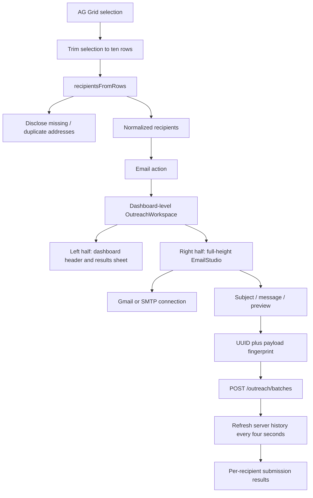
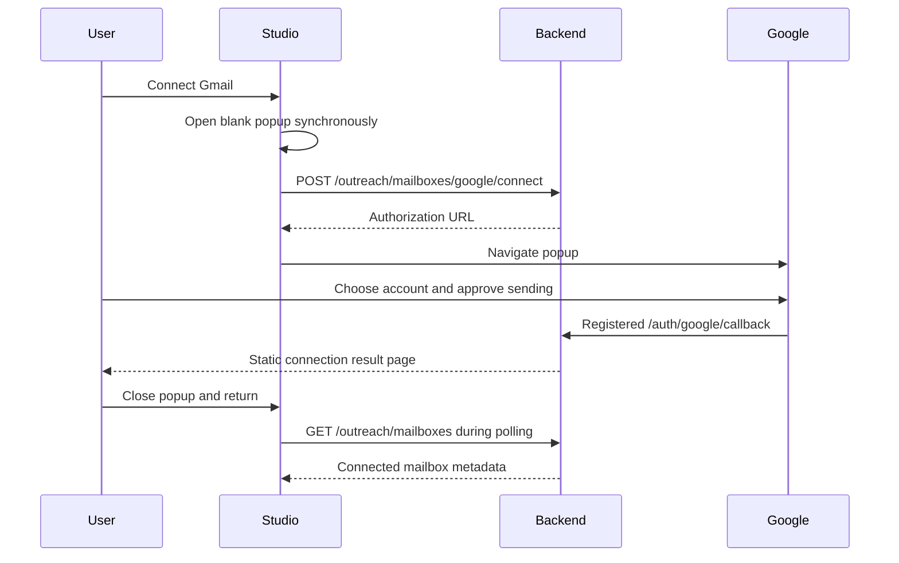

# Email outreach frontend implementation

## User experience

Select up to ten rows in the shared results table and click **Email**. The navigation remains above both workspaces. The dashboard and results sheet occupy the left floating canvas; Email Studio occupies the right canvas below the navigation. Both canvases have 26px corners, an inset margin, independent scrolling, subtle borders and layered shadows, separated by a 16px gap with a decorative blue handle. Closing the studio restores the dashboard's full width.

This changes the application layout inside the current browser tab. It does not open a second browser viewport. Gmail authorization uses a separate popup; sending does not.

The studio is mounted once above the dashboard in `OutreachWorkspace`. `app/components/ResultsTable.js` publishes selected recipients through context; the core export preview and Google Maps results sheet use that table. Specialized investor tables and Instagram/YouTube card grids are not integrated in this version. They can reuse the workspace context after providing the recipient contract described below.

Composition now includes rich text, subject/body personalization, starter templates, custom session templates, a draft signature and formatted recipient previews. Attachments, scheduled sends, automatic follow-ups and inbox reading are future extensions. Outlook is deferred.

## Source map

| File | Responsibility |
| --- | --- |
| `app/components/LeadGenApp.js` | Mounts the workspace around the complete dashboard |
| `app/components/outreach/OutreachWorkspace.js` | Full-viewport split, active source, recipients/exclusions, persistent studio |
| `app/components/ResultsTable.js` | Selection, ten-row cap, toolbar, publishing active-source recipients |
| `app/components/outreach/EmailStudio.js` | Compact sender launcher, composer, previews, send intents and history |
| `app/components/outreach/MailboxModal.js` | Sender selection, Gmail/SMTP connection, authentication checks and disconnect in a native modal |
| `app/components/outreach/RichComposer.js` | Formatting, links, undo/redo, plain-text paste/drop and variable insertion |
| `app/components/outreach/PersonalizedFields.js` | Actual lead details in editable subject/body, protected field chips and lossless token serialization |
| `app/components/outreach/composer.js` | Starter templates, client sanitation, HTML/text payloads and safe personalized preview |
| `app/components/outreach/recipients.js` | Known-field normalization, deduplication and preview substitution |
| `app/components/outreach/api.js` | Bearer-authenticated outreach API helper |
| `app/components/outreach/Outreach.module.css` | Scoped layout, controls, states, responsive styles |

Files use language-valid comments, with `// #` and `/* # ... */` sections to explain ownership, security boundaries and non-obvious behavior.

## Component/data flow



## Selection rules

- Header select-all is disabled for the shared table.
- Excess row selections are deselected through AG Grid APIs.
- Only selected row objects still present in current table data are eligible.
- Known email fields are inspected: `email`, `emails`, `emailAddress`, `email_address`, `work_email`, and `workEmail`.
- String lists and arrays are supported, including entries with `email`/`address` properties.
- The first syntactically usable address in each selected row is used.
- Each row contributes at most one recipient, even when it contains several addresses.
- Addresses are normalized to lowercase and deduplicated.
- Missing-email rows and duplicate addresses are counted in the toolbar.
- Arbitrary descriptions are never searched for addresses.

The limit applies to selected rows in the UI and unique recipients in the backend. The backend independently rejects more than ten recipients, duplicates and invalid addresses. Client checks do not replace server validation.

The studio allows removing recipient chips without changing the underlying table selection. **Restore recipients** clears these exclusions. Users with excluded recipients can still adjust table selection; the count shown in the send button is the actual outgoing recipient count.

## Recipient contract and personalization

```js
// # Pass real lead data only. Empty fields remain empty rather than invented.
const recipients = [{
  email: "lead@example.com",
  first_name: "Ada",
  company: "Example",
}];
```

Name mapping prefers `first_name`, then `firstName`, then the first word of `name`/`fullName`. Company mapping supports `companyName`, `company_name`, or `company`, including a company object with a `name`. Newlines are removed from these header-capable fields and lengths are bounded.

Supported placeholders:

| Placeholder | Value |
| --- | --- |
| `{{first_name}}` | Recipient first name |
| `{{company}}` | Recipient company |
| `{{email}}` | Normalized recipient address |

The preview recipient selector renders subject and body for one selected recipient. Missing fields remain visibly unresolved in the preview. The server rejects missing or unknown personalization fields before any batch is queued. The backend is authoritative for final rendered content.

The writing canvas now resolves personalization visually too: **Viewing email for** selects a lead, and subject/body display that lead's actual first name, company and email in protected inline details. Users do not need to understand template syntax. Changing the selected lead updates those displayed details without modifying the shared template. The editor serializes protected details back to the original fields before saving templates or sending; one lead's name is never baked into all recipients' messages by merely viewing or editing around it. Missing data is displayed as unavailable rather than invented. Toolbar labels and helper copy use ordinary language.

## Mailbox connection flows

### Profile inbox settings

The profile page mounts `components/profile/InboxSettings.js` as an independent account-settings section. It loads only `/outreach/mailboxes` and offers a confirmed DELETE to `/outreach/mailboxes/{id}`. Cards show real sender/provider metadata, a stored-link label, and a valid link date where present. They do not claim a fresh provider-authentication check. Loading and failed requests are distinct from an empty inbox list. A late list response is invalidated after a successful disconnect so it cannot restore a removed card.

Disconnect confirmation uses a native accessible dialog. Only the selected sending connection is removed after server success; an error leaves it visible and retryable. Sent history is retained, in-flight submissions may finish, and account sign-in/password settings are unaffected. This action does not revoke a Google OAuth grant remotely. No Google sign-in disconnect control is introduced. The existing password/OTP flow remains intact. The profile does not create new mailbox connections; users continue connecting through the studio's provider flow.

The writing canvas shows a single sender button displaying the selected email address or **Connect mailbox**. Clicking it opens `MailboxModal`; sender selection and provider settings are never expanded inline in the studio. The native `<dialog>` uses `showModal()` for top-layer rendering and background focus containment. Close, Done or Escape returns to the existing draft and restores focus to the button. The modal retains the dashboard's inherited theme and scrolls independently when its form exceeds the viewport.

The modal begins with Google, Outlook and Other provider cards. Outlook is disabled and labelled as coming later. Google opens a three-step guide before OAuth; Other opens Hostinger/Titan/custom SMTP settings. Provider → Connect → Ready indicates actual setup progress. Google success is detected from refreshed mailbox creation/update metadata, not merely from opening the OAuth popup. Users can return to provider selection without losing their email draft; unfinished SMTP credentials are cleared when leaving that setup step.

### Gmail



Opening the popup before the asynchronous request reduces popup-blocking issues. If blocked, the studio shows an actionable message. OAuth tokens, state storage, refresh and credentials are handled by the backend. The frontend receives only the authorization URL and public connection metadata.

No tokens are sent through popup messages or saved in browser storage. The callback page does not automatically close; it tells the user to close it. Failed/cancelled consent is explained in that window. Returning to the studio and reconnecting starts a fresh OAuth request.

### Hostinger / other SMTP

The user supplies sender name, email, SMTP username, mailbox/app password, hostname and a secure port. The username defaults to the email address when omitted.

Presets include Hostinger and Titan, plus Other SMTP. The encryption selector maps directly to port 465 SSL/TLS or port 587 STARTTLS. Arbitrary/insecure port settings are unavailable.

**Check & connect** authenticates server-side before storing the encrypted connection. The password lives only in modal component memory during entry and is cleared after successful connection. It is never saved to localStorage. Closing the mailbox modal unmounts the connection form and discards unfinished credentials, while the studio's writing draft remains intact. Successful SMTP connection selects the connected mailbox as sender.

The shield button checks the selected saved mailbox's authentication without sending email. Disconnect removes the server's local credentials. Reconnect Gmail or submit the SMTP form again to update credentials. Unsubmitted drafts remain intact during mailbox setup.

## Sending, retries and history

The outgoing payload includes a `request_id` UUID, `mailbox_id`, `recipients`, `subject`, and `body`.

1. A synchronous ref blocks duplicate clicks before React state updates.
2. A fingerprint records the exact outgoing payload.
3. The same payload reuses its UUID after a network failure.
4. A successful submission marks that intent accepted locally; another identical click shows that it is already queued.
5. Editing the payload creates a new intent/UUID.

The backend persists the idempotency key, so retries with the same ID remain protected across API workers. The frontend intent is in memory only. Reloading the page loses it; after an uncertain network outcome, inspect history before composing and submitting the same message again.

The panel refreshes mailbox metadata and the latest server history every four seconds while open. It stops the timer when hidden/unmounted. It shows the most recent five batches, with expandable per-recipient details. The server returns up to twenty batches; full pagination is not implemented.

| Display | Meaning |
| --- | --- |
| Queued | Persisted and waiting for the server consumer |
| Sending | Submission is in progress |
| Provider accepted | Provider accepted submission; inbox delivery unconfirmed |
| Failed | Rejected or not attempted because prerequisites failed |
| Skipped | Recipient opted out before submission |
| Uncertain | Outcome unknown; inspect provider history before sending again |

Batch `complete` means processing has ended and can include failed or uncertain recipients. The studio does not label provider acceptance as delivered, opened or read.

The server appends an unsubscribe link to each message. It is disclosed beside the send action and is not included in the editable text preview. Each message has one recipient and does not expose other selected leads.

## State and layout ownership

The shared table owns row selection. `OutreachWorkspace` owns visibility, the active table source ID, its published recipients, and excluded addresses. Only the table that opened the studio can update the active recipient list; hidden tables cannot overwrite it. The studio owns connection UI, draft, preview, request intent and polled history.

The studio is kept mounted with `hidden` when closed, preserving its in-memory draft. Closing a results sheet does not unmount the dashboard-owned studio. Navigation away from the dashboard, refresh or a dashboard unmount still discards the in-memory draft; there is no durable draft API. Closing the studio returns focus to its triggering Email button when still mounted.

CSS Modules scope workspace styling. The navigation is a separate workspace slot above the pane grid, so the studio cannot run underneath it. When open, the workspace is fixed to the viewport and uses equal-width columns below that slot. Its left app pane uses `transform: translateZ(0)` to establish a containing block for existing fixed-position sheets, backdrops and dialogs. Rounded overflow clips those descendants to the left canvas. Fixed bottom sheets have a 100% maximum height relative to that containing block. The studio is a sibling outside all sheet transforms, with a non-scrolling header and independently scrolling body. Theme is passed from the dashboard. At widths of 1050px and below, the preview retains its full width and the studio becomes a rounded bottom sheet within the area below navigation.

### Motion and keyboard behavior

The navigation keeps its regular full-width, square-edged appearance when split mode opens; only the canvases have floating rounded surfaces. The separator is draggable with pointer capture and one CSS update per animation frame. Left/right arrow keys resize by two percentage points; Home or double-click restores 50/50. Widths are bounded to 32–68% and at least 360px where space permits. Ratio persists while this dashboard remains mounted. On narrow screens the separator is hidden and the studio retains its bottom-sheet presentation. Table layout runs during intentional resize gestures; opening animation still avoids repeated table layout.

### Forms inside the resized preview canvas

The left pane is a named `lead-workspace` inline-size container. Its dashboard padding and desktop sidebar respond to the pane width, rather than the browser width. Below 700px on desktop, the sidebar becomes a labelled/tooltip-equipped icon rail, preserving step navigation. Earlier pipeline field grids stack when the pane is narrow, and the canvas owns vertical scrolling instead of nesting the main-content scrollbar.

`ExportStep.module.css` defines a separate `export-content` container for the actual form width. The summary stacks by default and becomes a separate 340px column only when at least 900px of form width is available. Output fields become two columns at 600px. Radio-card choices auto-fit with a 220px preferred minimum, and their text uses `min-width: 0` to wrap within the card. No breakpoint assumes that a desktop browser means a desktop-sized pane. The export sheet header wraps download/close controls, and its ResizeObserver measures the rendered, constrained sheet for drag thresholds. Automatic sheet opening is derived from fresh result identities; existing results can still be manually opened/closed.

Opening runs a 980ms translucent blue/cyan wave over the left canvas while a backing surface contracts and the right panel glides in over 900ms. The wave uses curved radial-gradient lobes and only transform/opacity animation. It has `pointer-events: none`, no large-area filters, and is removed on animation completion. There are no infinite animations or animation-frame measurement loops. The backing surface, rather than the table/text raster, scales: AG Grid commits its new geometry once instead of laying out every animation frame. Table text is never scaled. Title/sender/recipients/composer/send controls fade and rise with a short stagger that completes within the sweep.

Closing uses a 240ms exit before restoring full width. The component and draft remain mounted. Focus moves to the Email Studio region on opening; Escape dismisses the workspace unless a native mailbox dialog is handling it. After closing, focus returns to the triggering Email button without scrolling. Mailbox dialogs continue to own their native focus containment and Escape behavior independently.

With `prefers-reduced-motion: reduce`, the wave is not created on opening, travel and stagger are disabled, and opening/closing use 120ms opacity fades. Changing the preference with a panel open is covered by CSS. On narrower screens, entry/exit uses a short bottom-sheet translation; the simplified wave still runs over the preview when motion is allowed.

## API/environment contract

### Temporary lead-generation fixture switch

Set `NEXT_PUBLIC_OUTREACH_TEST_LEADS=true` in the frontend `.env` to bypass the core lead-generation request. Run immediately loads four fixture rows from `app/components/outreach/testLeads.js` into the existing results sheet, including when Bundle is selected. The fixture includes only the four supplied test email addresses; company, role and location details are synthetic. The sheet labels the data and offers a locally generated CSV. Nothing is persisted to backend lead/report storage by this path.

Set `NEXT_PUBLIC_OUTREACH_TEST_LEADS=false` (or remove it) to restore the real pipeline. Restart `npm run dev` after changing the flag; production requires a rebuild because Next.js embeds public environment values. The flag only affects the main lead-generation Run action. Gmail/SMTP connection and outreach sending remain real backend operations; other discovery modules and authentication are unchanged. Remove the flag and fixture module when integration testing is finished.

The only frontend environment requirement is the existing `NEXT_PUBLIC_API_URL`. Never add Google client secrets, SMTP passwords or the encryption key to `NEXT_PUBLIC_*` configuration.

The API helper reads the existing `renoweb_jwt` from localStorage and sends it as a bearer header. Server errors are displayed inline. All mailbox, send, history and disconnect operations require active-user authorization. The backend applies ownership filtering independently.

Backend deployment requires Google credentials, a stable encryption key and `OUTREACH_PUBLIC_API_URL`; see the backend's `docs/OUTREACH_SYSTEM.md` for the full configuration and queue design.

## Verification and manual review

No new test files or screenshot tests are required. In-memory checks can validate normalization, personalization and API contracts. Run targeted ESLint and the existing production build to validate compilation.

Implementation verification on October 22, 2026 passed targeted ESLint for the studio/shared table, in-memory recipient/personalization checks, and `npm run build` including the repository's existing comparison/testimonial checks. The first restricted build could not download existing Google Fonts; the network-enabled retry succeeded. The repository build configuration skips TypeScript type validation, so successful compilation is not a claim that a separate type check ran. No screenshots were captured.

Manual interaction checklist:

1. Select 0, 1, 10 and 11 rows; confirm the selection cap and counts.
2. Select rows with missing, duplicate and multiple email values.
3. Open/close the studio and confirm draft retention while the component remains mounted.
4. Check rounded desktop canvases below navigation, the non-interactive opening wave, left-confined sheet/backdrop, independent scrolling, narrow-screen studio bottom sheet, reduced-motion fades, Escape/focus restoration, and full-width restoration after closing.
5. Remove/restore recipient chips and switch preview recipient.
6. Connect Gmail, cancel consent, block popups, and reconnect.
7. Check SMTP invalid credentials and both TLS modes with an approved mailbox.
8. Send only to approved verification recipients; inspect per-recipient statuses.
9. Repeat the same Send action and verify the existing intent is not duplicated.
10. Open unsubscribe confirmation and verify later sends are blocked.

Visual interaction and real-provider verification remain separate from compilation and mocked checks. No live emails are sent automatically during build/validation.

## Extension points

Specialized tables/card grids inside the dashboard can use `useOutreachWorkspace()` to call `openStudio(sourceId, recipients, triggerButton)` and `updateRecipients(sourceId, recipients)`. Use a stable source ID, keep selection capped, and disclose missing/duplicate addresses at the source view. Do not mount another studio within a results sheet.

Rich-text composition uses server-side sanitization and multipart MIME. Scheduled sends, reply synchronization and provider delivery events require new backend data contracts. They must not be simulated with frontend status labels.

## Advanced writing tools

### Blue note email design

The starter library includes **The blue note**, an editable outreach introduction with the opt-in `studio` presentation. Applying it selects the designed frame and opens the formatted preview. The **Email design** selector switches between Minimal and Blue note without replacing the user's message. Saved session templates retain their design choice.

`emailPresentation.js` uses `emailDesign.json` to render the same frame as the backend: email-safe tables, inline spacing/type styles, a navy introduction, a blue callout and a restrained unsubscribe footer. It contains no external images, scripts, tracking or fabricated performance claims. Body headings are preserved by both sanitation layers. The signature remains editable through the existing signature control. Sender metadata comes from the selected mailbox; before connection, the preview uses explicit UI placeholders. The preview unsubscribe link is inert inside the existing sandbox.

The authoritative frame is `lead-gen-backend/outreach/templates/studio.html`, with trusted tag styles in `outreach/presentation.py`. `emailDesign.json` is a synchronized frontend copy of those assets. Update both when changing design and verify their equality. The standalone `artifacts/leads-outreach-template.html` shows this frame with clearly illustrative sender/company details and a non-operational unsubscribe link. It is an actual HTML artifact, not a screenshot.

The composer follows the admin studio's writing layout while keeping user-owned mailbox authorization separate. It provides bold, italic, underline, bullet/numbered lists, links, undo/redo and insertion buttons for the three supported personalization fields. It uses the same browser editing-command approach already used by the admin editor. Pasted/dropped content is inserted as plain text. Browser-side allowlist sanitation removes active content and unapproved link schemes; backend sanitation remains authoritative.

Starter templates are editable suggestions and are never sent automatically. Custom templates saved through the name field exist only in this component's session state and disappear on dashboard unmount/refresh. The signature is also draft state, appended to both outgoing HTML and plain text. Word/character counts cover the message body. Client and server enforce the existing 30,000-character text limit; formatted HTML is limited to 60,000 characters.

Formatted previews use a sandboxed iframe with no script/navigation permissions and a restrictive content-security policy. Recipient values are escaped before substitution. The preview is visually isolated from page styles; it does not execute embedded content or load remote email assets. Payloads now include optional `body_html` plus plain `body`, and the backend derives its final fallback text from sanitized, personalized HTML. Existing plain-text API clients remain supported. No AI drafting service or automatic follow-up sequence is implied by these manual writing tools.
